# Awesome Identity & User Management 🛡️

<div align="center">



<br/><br/>

<a href="https://github.com/ishandutta2007/Awesome-Awesome-Awesome"></a>
<a href="https://discord.gg/jc4xtF58Ve"></a>
<a href="https://github.com/ishandutta2007/Awesome-Identity-User-Management/stargazers"></a>
<a href="https://github.com/ishandutta2007/Awesome-Identity-User-Management/network/members"></a>
<a href="https://github.com/ishandutta2007/Awesome-Identity-User-Management/blob/main/LICENSE"></a>
<a href="https://github.com/ishandutta2007/Awesome-Identity-User-Management/pulls"></a>
<a href="https://github.com/ishandutta2007"></a>

<br/>

**A Curated List of Enterprise SaaS Platforms, Customer IAM (CIAM), and Self-Hosted Open-Source Identity & Access Management (IAM) Infrastructure.**

*Tracking Authentication, Authorization, Single Sign-On (SSO), SAML 2.0, OpenID Connect (OIDC), OAuth 2.1, Passkeys, Multi-Factor Authentication (MFA), SCIM Directory Sync, and Zero Trust Architectures.*

**Last updated: October 2026** ⚡

</div>

---

## 🧭 Table of Contents

- [📊 Sector Overview & Market Dynamics](#-sector-overview--market-dynamics)
- [☁️ SaaS / Hosted Identity Platforms](#️-saas--hosted-identity-platforms)
- [🔓 Open-Source Identity & Access Management (IAM)](#-open-source-identity--access-management-iam)
  - [🏆 Tier 1: Enterprise & Cloud-Native Platforms (>15,000 Stars)](#-tier-1-enterprise--cloud-native-platforms-15000-stars)
  - [🚀 Tier 2: Developer CIAM & Federation Engines (<15,000 Stars)](#-tier-2-developer-ciam--federation-engines-15000-stars)
- [💡 Architectural Decision Guide](#-architectural-decision-guide)
- [🤝 How to Contribute](#-how-to-contribute)
- [💖 Support & Sponsorship](#-support--sponsorship)
- [📈 Star History](#-star-history)
- [⚖️ Disclaimer](#️-disclaimer)

---

## 📊 Sector Overview & Market Dynamics

The global **Identity and Access Management (IAM)** market is estimated at **$24B–$30B in 2025–2026** and continues to grow at double-digit CAGR driven by Zero Trust architectures, enterprise cloud migrations, stringent compliance mandates (GDPR, HIPAA, SOC 2), and the rapid emergence of non-human and AI-agent workload identities.

The sector exhibits a **moderately concentrated core with a highly fragmented fringe**:
- **Enterprise Concentration**: Hyperscalers and heavyweight IAM incumbents (**Microsoft Entra ID**, **Okta/Auth0**, and **Ping Identity**) command the majority of large enterprise contracts and Fortune 500 employee directories.
- **Innovation & Fringe Fragmentation**: Rapid technological shifts have spurred a thriving ecosystem of specialized alternatives. Developer-first CIAM, passkey infrastructure, B2B enterprise federation gateways (e.g., WorkOS), and modern self-hosted open-source IdPs (e.g., Keycloak, Authentik, Zitadel, Ory) capture immense developer mindshare and satisfy data sovereignty requirements without punitive per-MAU subscription taxes.

---

## ☁️ SaaS / Hosted Identity Platforms

Below is a detailed comparison of market-leading managed Identity-as-a-Service (IDaaS) and Customer Identity and Access Management (CIAM) vendors, sorted by corporate valuation / scale in descending order:

| Company / Product | Size / Valuation (Descending) 🏢 | Starting Tier Pricing 💳 | Free Tier / Trial Limits 🎁 | Key Features & Focus 🔍 |
| :--- | :--- | :--- | :--- | :--- |
| **[Microsoft Entra ID](https://www.microsoft.com/en-us/security/business/identity-access/microsoft-entra-id)** | **~$3.94T Market Cap** (Microsoft parent; $20B+ annual cybersecurity business) | **$6.00 / user / month** (Entra ID P1, billed annually) | **Permanent free tier** included with Azure/M365 accounts; capped at 50,000 directory objects (expandable to 300,000 objects with verified custom domain), Security Defaults MFA only, no SLA, and no Conditional Access. | Ubiquitous enterprise cloud identity tightly integrated with Azure, Office 365, and Windows; conditional access, Privileged Identity Management (PIM), and governance. |
| **[Okta](https://www.okta.com/)** | **~$33B Market Cap** (~$2.9B ARR) | **$6.00 / user / month** (Starter Suite; requires $1,500/year contract minimum) | **30-day free trial**; includes access to workforce identity features and Okta Workflows capped at 5 active flows and 2 million step executions during the trial. | Enterprise workforce identity market leader with Universal Directory, SSO, adaptive risk-based MFA, automated lifecycle provisioning, and governance. |
| **[Auth0 (Okta)](https://auth0.com/)** | **$6.5B Acquisition Valuation** (acquired by Okta; part of Customer Identity Cloud) | **$35.00 / month** (B2C Essentials up to 500 MAUs) / **$150.00 / month** (B2B Essentials up to 500 MAUs) | **Permanent free tier** up to **25,000 Monthly Active Users (MAUs)**; includes unlimited social logins, passwordless/passkeys, up to 5 organizations, and 1 custom domain (excludes custom DBs and separate dev/prod environments). | Developer-friendly CIAM with extensible JavaScript Actions/Rules, extensive SDK ecosystems, passwordless authentication, and seamless social/enterprise auth. |
| **[Ping Identity (ForgeRock)](https://www.pingidentity.com/)** | **$2.8B Acquisition Valuation** (combined with ForgeRock by Thoma Bravo; ~$800M ARR) | **$3.00 / user / month** (PingOne Workforce Essential, 5,000-user minimum) / **$35,000 / year** (PingOne Customer Essential base package) | **30-day free trial**; capped at up to 1,000 active identities and 5 sandbox environments with standard rate and messaging thresholds. | Enterprise-grade workforce and CIAM platform with AI-driven risk scoring, decentralized identity, DaVinci orchestration, and hybrid deployment support. |
| **[JumpCloud](https://jumpcloud.com/)** | **$2.6B Valuation** (Series F; ~$150M–$200M ARR) | **$9.00 / user / month** (Device Management, billed annually) / **$11.00 / user / month** (SSO bundle, billed annually) | **30-day free trial** for new sign-ups with full-platform access; permanent free tier was discontinued for accounts created after Feb 1, 2024. | Cloud Directory-as-a-Service uniting cross-OS device management (MDM for Mac/Windows/Linux), Cloud LDAP/RADIUS, and SSO for SMBs and mid-market teams. |
| **[WorkOS](https://workos.com/)** | **$2.0B Valuation** (Series C; ~$30M ARR) | **$125.00 / connection / month** (SSO 1–15 connections; Directory Sync/SCIM billed separately at $125/connection/month) | **Permanent free tier** for core auth (AuthKit) up to **1,000,000 Monthly Active Users (MAUs)**; includes user management, social auth, MFA, passkeys, and free staging environments (enterprise SSO/SCIM require paid connections). | Developer platform designed specifically for B2B SaaS enterprise readiness (Enterprise SAML/OIDC SSO, SCIM Directory Sync, and Admin Portals). |
| **[OneLogin (One Identity)](https://www.onelogin.com/)** | **~$500M Est. Acquisition Valuation** (acquired by One Identity / Quest Software; ~$60M estimated ARR) | **$4.00 / user / month** (Advanced Plan, billed annually) | **30-day free trial**; includes full access to Cloud Directory, desktop/mobile SSO, MFA, VPN integration, and standard security reporting policies. | Cloud SSO and identity management providing directory sync, smart MFA, and workforce provisioning across enterprise SaaS suites. |

---

## 🔓 Open-Source Identity & Access Management (IAM)

*Self-hosted IAM gives organizations complete data sovereignty, predictable infrastructure costs, zero per-MAU scaling taxes, and full auditability.*

All repositories below are ranked and sorted in **descending order by GitHub Stars_Count**. Each badge is styled with `style=social` and `color=white`, linking directly to that repository's stargazers page:

### 🏆 Tier 1: Enterprise & Cloud-Native Platforms (>15,000 Stars)

1. **[Keycloak](https://github.com/keycloak/keycloak)**  
   [](https://github.com/keycloak/keycloak/stargazers)  
   **The open-source IAM standard.** Red Hat-backed CNCF project with the broadest protocol support in the industry: OpenID Connect (OIDC), OAuth 2.0, SAML 2.0, and LDAP/Kerberos federation.  
   - **Strengths**: Closest feature parity to commercial legacy platforms (ForgeRock, Ping); battle-tested clustering, fine-grained access management, and enterprise identity brokering.  
   - **Trade-offs**: Java/Quarkus runtime is memory-heavy; custom UI theming is notoriously complex compared to modern headless stacks; operational burden for clustering upgrades.  
   - **Best For**: Large enterprises requiring comprehensive standard compliance and teams with existing Java/Kubernetes operational expertise.

2. **[Authelia](https://github.com/authelia/authelia)**  
   [](https://github.com/authelia/authelia/stargazers)  
   **The reverse-proxy authentication specialist.** Go-based forward-authentication companion designed to sit in front of reverse proxies like Traefik, Nginx, Caddy, HAProxy, and Envoy.  
   - **Strengths**: Lightweight, fast, OpenID Certified, and post-quantum cryptography ready. Seamlessly secures internal services with 2FA/MFA (TOTP, WebAuthn/Passkeys, Duo) and file-based or LDAP/SQL user databases.  
   - **Trade-offs**: Not an all-in-one general IdP for SaaS user management; limited SAML identity provider functionality.  
   - **Best For**: Homelabs, internal developer tooling, and self-hosted environments that need reverse-proxy access control without deploying a heavy identity server.

3. **[NextAuth.js (Auth.js)](https://github.com/nextauthjs/next-auth)**  
   [](https://github.com/nextauthjs/next-auth/stargazers)  
   **The ubiquitous TypeScript/JavaScript authentication framework.** Complete open-source authentication library designed for Next.js, SvelteKit, Express, and modern full-stack web applications.  
   - **Strengths**: Massive ecosystem; built-in connectors for 80+ OAuth providers; native support for JWT sessions, database sessions (Prisma, Drizzle, TypeORM), and WebAuthn.  
   - **Trade-offs**: Code-level library rather than a standalone IdP server; you manage your own database migrations and user administration interface.  
   - **Best For**: Full-stack JavaScript and TypeScript teams building web apps who want complete code ownership over their session layer.

4. **[Authentik](https://github.com/goauthentik/authentik)**  
   [](https://github.com/goauthentik/authentik/stargazers)  
   **The modern alternative with visual ergonomics.** Python/Go container-native IdP featuring a powerful **visual flow engine** to design arbitrary authentication, enrollment, and recovery pipelines.  
   - **Strengths**: Markedly superior admin dashboard and UI theming compared to Keycloak; native support for OIDC, SAML, LDAP outposts, proxy forward auth, and RADIUS outposts; clean MIT core.  
   - **Trade-offs**: Younger community and ecosystem than Keycloak; flow engine has a conceptual learning curve.  
   - **Best For**: Teams wanting self-hosted IAM with modern ergonomics, flexible custom logic flows, and built-in proxy outposts.

5. **[ZITADEL](https://github.com/zitadel/zitadel)**  
   [](https://github.com/zitadel/zitadel/stargazers)  
   **The cloud-native multi-tenant IdP.** Go-based identity platform engineered with **turnkey multi-tenancy** (instances, organizations, and projects) and an **event-sourced architecture**.  
   - **Strengths**: Built-in support for B2B SaaS tenancy, passwordless passkeys/FIDO2, audit trail event streaming, and custom TypeScript Actions.  
   - **Trade-offs**: Smaller integration catalog than 10-year-old incumbents; AGPL-3.0 copyleft license must be evaluated for specific embedded commercial distributions.  
   - **Best For**: Modern B2B SaaS applications requiring frictionless multi-tenant organization switching and cloud-native Kubernetes deployment.

6. **[SuperTokens](https://github.com/supertokens/supertokens-core)**  
   [](https://github.com/supertokens/supertokens-core/stargazers)  
   **The modular developer CIAM architecture.** Open-source alternative to Auth0, Firebase Auth, and AWS Cognito, architected into a core backend service coupled with pre-built, customizable frontend SDK widgets (React, Vue, Angular).  
   - **Strengths**: Modular recipe architecture (Session management, Social login, EmailPassword, Passwordless, User Roles, Multi-Tenancy); end-to-end anti-CSRF token rotation; exceptional developer docs.  
   - **Trade-offs**: Requires hosting both the SuperTokens core daemon and mounting their SDK handlers within your app API backend.  
   - **Best For**: Full-stack product engineering teams wanting drop-in auth UI with complete backend data control.

---

### 🚀 Tier 2: Developer CIAM & Federation Engines (<15,000 Stars)

7. **[Logto](https://github.com/logto-io/logto)**  
   [](https://github.com/logto-io/logto/stargazers)  
   **The modern, developer-first alternative to Auth0.** TypeScript/Node.js based customer identity solution with a stunning administration console, sign-in experience builder, and multi-tenant support.  
   - **Strengths**: OIDC/OAuth 2.0 certified; passkeys; organization management; role-based access control (RBAC); native multi-language SDKs (React, Next.js, iOS, Android, Flutter).  
   - **Trade-offs**: Relatively newer project compared to Keycloak.  
   - **Best For**: Startups and product teams looking for an Auth0-equivalent developer UX that can be self-hosted via Docker or deployed to cloud infra.

8. **[Casdoor](https://github.com/casdoor/casdoor)**  
   [](https://github.com/casdoor/casdoor/stargazers)  
   **The versatile Go-based UI-first IdP with MCP support.** Apache-2.0 licensed IAM platform supporting OAuth 2.0/OIDC, SAML, CAS, LDAP server, RADIUS, and **Model Context Protocol (MCP) server integration** for AI agent auth.  
   - **Strengths**: Out-of-the-box web UI; built-in connectors for 70+ social and enterprise providers (including Google, GitHub, WeChat, DingTalk, Lark); native Casbin authorization engine.  
   - **Trade-offs**: Community documentation is lighter in some enterprise edge-cases; fast-evolving codebase.  
   - **Best For**: Teams needing a lightweight Go-based IdP with wide international identity provider support and cutting-edge AI/MCP capabilities.

9. **[Ory Kratos](https://github.com/ory/kratos)** *(Part of the [Ory Network](https://github.com/ory))*  
   [](https://github.com/ory/kratos/stargazers)  
   **The headless, API-first identity & user management engine.** Go-based headless identity primitive providing user registration, login, profile management, MFA, and recovery via clean REST APIs.  
   - **Strengths**: Completely headless—gives you 100% control over UX/UI branding without iframe or redirect hacks; composable with **Ory Hydra** (OAuth 2.0/OIDC server), **Ory Keto** (Zanzibar authorization), and **Ory Oathkeeper** (Identity proxy).  
   - **Trade-offs**: "Bring Your Own UI"—requires software engineering effort to build and maintain the frontend auth interfaces.  
   - **Best For**: Microservice architectures and engineering teams requiring custom login UX with headless API-driven identity pipelines.

10. **[Dex](https://github.com/dexidp/dex)**  
    [](https://github.com/dexidp/dex/stargazers)  
    **The lightweight OpenID Connect pluggable federator.** CNCF sandbox project written in Go acting as an identity broker between apps and backend user directories (SAML, LDAP, GitHub, GitLab, Google).  
    - **Strengths**: Extremely light footprint; rock-solid reliability; widely adopted across Kubernetes ecosystems and enterprise infrastructure to provide OIDC authentication to clusters.  
    - **Trade-offs**: Not a full-fledged user database (it acts as a connector/broker, delegating storage to other directories).  
    - **Best For**: Kubernetes cluster auth federation and small services requiring clean OIDC proxying into enterprise directories.

11. **[Lucia](https://github.com/lucia-auth/lucia)**  
    [](https://github.com/lucia-auth/lucia/stargazers)  
    **The minimalist session and auth toolkit.** A lightweight, unopinionated TypeScript resource and abstraction library focused on session handling and authentication primitives without bloat.  
    - **Strengths**: Gives complete insight into session mechanics; zero runtime magic; database adapters across SQLite, PostgreSQL, MySQL, and MongoDB.  
    - **Trade-offs**: Provides learning guides and minimal helpers rather than an autonomous IdP server.  
    - **Best For**: Developers who want to build and understand their own lightweight session authentication from first principles.

12. **[node-oidc-provider](https://github.com/panva/node-oidc-provider)**  
    [](https://github.com/panva/node-oidc-provider/stargazers)  
    **The OpenID Certified OAuth 2.0 / OIDC Server for Node.js.** Maintained by Filip Skokan, this is the gold-standard OpenID Certified specification implementation in JavaScript/Node.js.  
    - **Strengths**: Meticulous standards conformance with OAuth 2.0, OAuth 2.1, OIDC, FAPI, and PKCE; highly extensible mounting inside Express, Fastify, or Koa.  
    - **Trade-offs**: Developer library requiring implementation of interaction controllers and persistence stores.  
    - **Best For**: Node.js backends needing to expose a strictly certified OpenID Connect identity provider service.

13. **[WSO2 Identity Server](https://github.com/wso2/product-is)**  
    [](https://github.com/wso2/product-is/stargazers)  
    **The enterprise API-driven CIAM platform.** Apache-2.0 licensed, enterprise-grade IAM platform optimized for complex integration scenarios, API management, and federation across hybrid enterprise estates.  
    - **Strengths**: Deep integration with WSO2 API Manager; adaptive risk-based authentication; federated access across legacy directories; extensive compliance capabilities.  
    - **Trade-offs**: Java enterprise footprint; steeper configuration and administrative curve.  
    - **Best For**: Large-scale financial institutions, telecoms, and enterprises with existing WSO2 footprints and intricate API security boundaries.

---

## 💡 Architectural Decision Guide

```
                      Do you need a managed cloud service?
                                 /          \
                              [Yes]        [No]
                              /                \
                Need internal workforce?     Need complete self-hosted ownership
                  /             \                        /              \
            [Workforce]       [B2B / CIAM]         [All-in-One]     [Headless / Library]
              /      \          /        \              |                    |
        Microsoft    Okta    Auth0     WorkOS      Keycloak (Java)      NextAuth.js (TS)
        Entra ID                                   Authentik (Py/Go)    SuperTokens (Core)
                                                   ZITADEL (Go)         Ory Kratos (Go)
                                                   Authelia (Proxy)     node-oidc-provider
```

- **Choose Keycloak** when you need maximum protocol support (SAML, OIDC, Kerberos) and enterprise maturity, and your team is comfortable maintaining Java/Kubernetes infrastructure.
- **Choose Authentik** when you need a self-hosted IdP with exceptional UX, modern container architecture, and visual flow design.
- **Choose ZITADEL** when building modern B2B SaaS applications requiring native multi-tenancy and audit event streaming.
- **Choose Ory (Kratos + Hydra)** when you want headless, API-first identity primitives and intend to build your own bespoke frontend authentication UI.
- **Choose Authelia** when you need a lightweight forward-auth gatekeeper in front of reverse proxies for homelabs or internal web services.
- **Choose WorkOS or Auth0** when you prefer managed SaaS to accelerate B2B enterprise readiness (SAML SSO / SCIM Directory Sync) without operating auth servers.

---

## 🤝 How to Contribute

Contributions are warmly welcomed! Help make this the most comprehensive and up-to-date IAM resource on GitHub:

1. 🍴 **Fork** the repository.
2. 🌿 **Create** a feature branch: `git checkout -b feature/add-new-idp`.
3. 📝 **Add/edit** entries in [README.md](file:///C:/Users/ishan/Documents/Projects/Awesome-Identity-User-Management/README.md).
   - Keep descriptions factual and technically precise.
   - For SaaS additions, provide exact starting pricing, free tier/trial limits, and company scale.
   - For open-source additions, include the official GitHub Stars_Badge with `style=social&color=white` linking to `/stargazers`.
4. 🚀 **Commit** changes with clear messages.
5. 📬 **Submit** a Pull Request with a short summary of changes.

---

## 💖 Support & Sponsorship

If this curated repository helped you design your identity architecture, evaluate auth vendors, or save time building authentication infrastructure, please consider showing your support:

- ⭐ **Star this repository** to help others discover it!
- 🍴 **Fork and share** it with your engineering team or community.
- ☕ **Sponsor the Maintainer**: Support ongoing curation and open-source maintenance via the [GitHub Sponsor Dashboard](https://github.com/sponsors/ishandutta2007).

<div align="center">

<a href="https://github.com/sponsors/ishandutta2007">
  
</a>

<p><em>Thank you to all community contributors, security architects, and developers who keep this ecosystem thriving!</em></p>

</div>

---

## 📈 Star History

[](https://star-history.dera.page/#ishandutta2007/Awesome-Identity-User-Management&type=date&legend=top-left)

---

## ⚖️ Disclaimer

- This is a **community-curated, independent list** — not exhaustive, non-promotional, and not an endorsement of any vendor.
- **Self-hosted IAM shifts operational burden to you**: authentication is security-critical infrastructure. Plan for high availability, backup strategies, automated upgrades, and rapid CVE security patching.
- **Licensing matters**: Keycloak and Casdoor are Apache-2.0; ZITADEL is AGPL-3.0; Authentik is MIT core with commercial enterprise extensions. Verify license compatibility before deploying in commercial proprietary products.
- **No single solution fits all workloads**: Match each tool against your compliance boundaries, team skillsets, and infrastructure capabilities.

---

<div align="center">
  <sub>Built for platform engineers, security architects, and software developers building modern authentication infrastructure.</sub>
</div>
